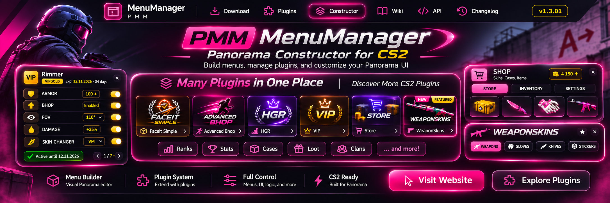
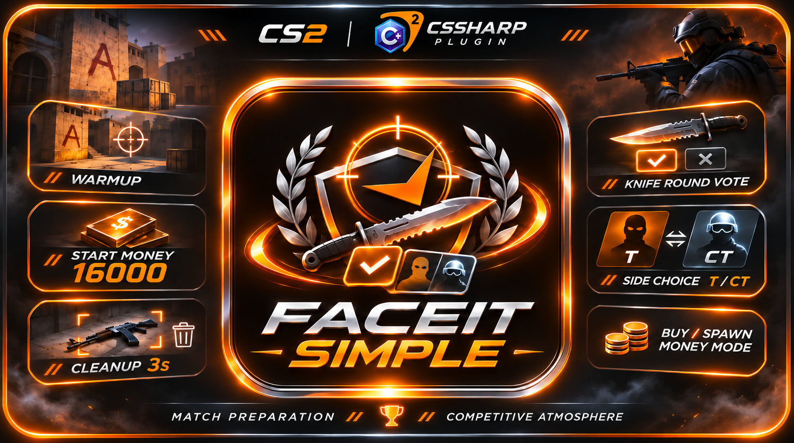

# Faceit-Simple-CS2

[](https://boosty.to/rimmerquinella)

<a href="https://genesis-cs.space/menuconstructor/menumanager/plugins/">
  
</a>

<h3 align="center">Больше моих плагинов и более подробная информация на моем сайте</h3>
<h2 align="center"><a href="https://genesis-cs.space/menuconstructor/menumanager/plugins/">GENESIS-CS.SPACE</a></h2>

<a href="https://genesis-cs.space/menuconstructor/menumanager/plugins/">
  
</a>

[English](#english) · [Русский](#русский)

### Demo / Демо

[Watch the Faceit-Simple-CS2 demonstration on YouTube / Смотреть демонстрацию Faceit-Simple-CS2 на YouTube](https://youtu.be/mGGGrA2bFYc)

## English

**Faceit-Simple-CS2 0.1.1** by **Rimmer** brings the Faceit-style warmup to CS2: unlimited warmup money, dropped weapons cleaned up, a knife vote on a Panorama card, a knife-only first round and the winners picking their side before the match starts at 0:0. It is a port of the CS:GO SourceMod plugin [*Faceit Warmup 2.0*](https://github.com/RRimmer/Faceit-Warmup) by the same author; the original all-talk on warmup was dropped on purpose.

### Requirements

- CS2 dedicated server with [CounterStrikeSharp](https://github.com/roflmuffin/CounterStrikeSharp) **1.0.380** (.NET 10).
- No other plugins and no config dependencies. A client addon is optional: without it the vote works through chat.

### Warmup

- **Money:** `StartMoney` (16000) is restored after every purchase (`MoneyMode: 0`) or after every spawn (`MoneyMode: 1`), for T and CT, only while the warmup lasts.
- **Dropped weapons:** every `DeleteDroppedInterval` seconds (3) the plugin removes `weapon_*` and `item_*` entities that have no owner. Weapons in hands and everything on the ground after the warmup are left alone.
- **Weapon type count:** `mp_weapons_allow_typecount` is `-1` on warmup and `2` in the match; both values and the switch itself are configurable.

### Knife vote

- `KnifeVoteBeforeEnd` seconds (30) before the warmup ends, a small card appears on the right side: the title, the time left, two buttons with live vote counters.
- Players vote with the mouse — the cursor is captured, the cross releases it, `!vote` brings it back and allows changing the vote. The chat fallback works in parallel: `1` / `2`, `yes` / `no`, `да` / `нет` — the full word lists live in `ChatType`.
- Late joiners get the vote too, while at least `VoteJoinUntil` seconds (5) remain.
- `KnifeRoundMode`: `vote` (default), `always` (no vote, the knife round just happens) or `off`. A tie or an empty vote follows `KnifeVoteTieResult`.
- `MenuType` picks the input: `1` mouse and chat, `2` mouse only, `3` chat only — the card is still shown, without the cursor and the cross.

### Knife round

- Before the round starts: no C4, no buying, no default pistols, money 0.
- Every player is stripped to a knife; `KnifeHealth` and `KnifeArmor` (0 none, 1 vest, 2 vest and helmet) set the loadout.
- `KnifeResetDelay` seconds (5) into the round everyone is stripped **once more**. VIP plugins hand out rifles, a healthshot, HP and armor a moment after the spawn, and some players grab a weapon right away — this reset removes all of it, so the knife round stays a knife round.
- `KnifeCvars` are applied for the round — bunny hop and fast movement by default — and `AfterKnifeCvars` sets the normal movement afterwards. Values of every touched cvar are remembered and restored; an empty `AfterKnifeCvars` restores all of them.
- A draw replays the knife round.

### Side pick

- `KnifeRoundEndDelay` seconds (1) after the knife round the server starts a paused warmup (`mp_warmup_pausetimer 1`).
- Only the winners vote: **T** or **CT**, on the same card, mouse or `!t` / `!ct`. The losers see "the winners are choosing a side".
- The vote ends after `SideVoteTime` seconds (15) or as soon as every winner has voted. If the pick differs from the winning side, the teams are swapped.
- `mp_warmup_end` starts the match at 0:0 and every changed cvar is restored.

### Configuration

`addons/counterstrikesharp/configs/plugins/Faceit-Simple-cs2/Faceit-Simple-cs2.jsonc` is created on first load with comments. An existing file is never rewritten; `css_faceitsimple reload` reads it again.

| Key | Default | Effect |
| --- | --- | --- |
| `Enabled` | `true` | Master switch. |
| `StartMoney` | `16000` | Money on warmup. |
| `MoneyMode` | `0` | `0` after a purchase, `1` after a spawn. |
| `DeleteDroppedInterval` | `3` | Seconds between dropped-weapon sweeps, `0` off. |
| `ControlTypeCount` | `true` | Whether the plugin touches `mp_weapons_allow_typecount`. |
| `WarmupTypeCount` | `-1` | Value on warmup. |
| `MatchTypeCount` | `2` | Value in the match. |
| `KnifeRoundMode` | `vote` | `vote`, `always` or `off`. |
| `KnifeVoteBeforeEnd` | `30` | Seconds before the warmup ends when the vote appears. |
| `KnifeVoteTieResult` | `false` | Tie or no votes: `true` still plays the knife round. |
| `VoteJoinUntil` | `5` | Late joiners get the vote while at least N seconds remain. |
| `KnifeArmor` | `0` | `0` none, `1` vest, `2` vest and helmet. |
| `KnifeHealth` | `100` | Health on the knife round. |
| `KnifeResetDelay` | `5` | Seconds until the one extra full reset, `0` off. |
| `KnifeRoundEndDelay` | `1` | Seconds between the knife round and the side vote. |
| `SideVoteTime` | `15` | Seconds the winners have to pick a side. |
| `KnifeCvars` | bhop set | Cvars for the knife round, `"name value"` lines. |
| `AfterKnifeCvars` | normal set | Cvars afterwards; `[]` restores the remembered values. |
| `MenuType` | `1` | `1` mouse and chat, `2` mouse, `3` chat. |
| `ChatType` | `1/2, yes/no, да/нет` | Words accepted as votes; `!` and `/` are optional, case is ignored. |
| `LayoutPath` | `...faceit_simple_cs2.vxml_c` | Compiled card layout in the client addon. |
| `Debug` | `false` | Verbose log. |

### Commands

| Command | Where | Purpose |
| --- | --- | --- |
| `css_faceitsimple` | Server console | Status: enabled, warmup, phase, warmup time left, votes, knife winner, HUD. |
| `css_faceitsimple reload` | Server console | Re-read the config. |
| `!vote` / `css_vote` | Chat / client | Bring the cursor back and allow changing the vote. |
| `1`, `2`, `!t`, `!ct` … | Chat | Vote with the words listed in `ChatType`. |

### Install from a release

1. Install CounterStrikeSharp **1.0.380**.
2. Take `Faceit-Simple-CS2-0.1.1.zip` from [Releases](../../releases/latest) and copy `Server-plugins/counterstrikesharp/` into `game/csgo/addons/counterstrikesharp/`.
3. Restart the server or run `css_plugins load Faceit-Simple-cs2`.
4. The config is created on first load; edit it and run `css_faceitsimple reload`.
5. Optional: compile the vote card into a client addon — see [Client addon](#client-addon).

### Client addon

`Content-addonmanager/panorama/` holds two files:

| Path | Contents |
| --- | --- |
| `layout/custom_game/faceit_simple_cs2.xml` | The card: title, timer, two buttons, hint, close cross. |
| `styles/custom_game/faceit_simple_cs2.css` | Colours, position (right side, editable in `.sf-root`) and the states the plugin toggles. |

Compile both into your client addon (MultiAddonManager) and change the map. Without the addon the whole flow still works through chat.

### Repository layout

| Path | Contents |
| --- | --- |
| `Faceit-Simple-cs2/` | Plugin sources, project file and `lang/`. |
| `Faceit-Simple-cs2.example.jsonc` | Commented config; the archive ships it as `Faceit-Simple-cs2.jsonc`. |
| `Content-addonmanager/` | Panorama card for the client addon. |
| `pack.cmd` / `pack.ps1` | Release build and ZIP. |
| `.github/workflows/` | Build and ZIP on every push. |

### Build

With .NET SDK 10:

```bash
dotnet build Faceit-Simple-cs2/Faceit-Simple-cs2.csproj -c Release
```

On Windows `pack.cmd` builds the plugin and writes `Faceit-Simple-CS2-0.1.1.zip` into the repository root: `Server-plugins/`, `Content-addonmanager/`, `Source/` and the docs. CI produces the same archive as an artifact.

### Credits

- *Faceit Warmup 2.0* for CS:GO — **Rimmer** ([Faceit-Warmup](https://github.com/RRimmer/Faceit-Warmup)).
- CS2 port, Panorama card and the knife/side vote flow — **Rimmer**.

### License

The plugin is licensed under the **GNU GPL v3** — see [LICENSE](LICENSE). No third-party assets are bundled: the card is plain Panorama XML and CSS.

[Installation guide](INSTALL.md) · [Changelog](CHANGELOG.md) · [License](LICENSE)

---

## Русский

**Faceit-Simple-CS2 0.1.1** от **Rimmer** — разминка в стиле Faceit для CS2: деньги без ограничений, очистка выпавшего оружия, голосование за ножевой раунд на панорамной плашке, первый раунд только с ножами и выбор стороны победителями перед стартом матча с 0:0. Это порт CS:GO-плагина [*Faceit Warmup 2.0*](https://github.com/RRimmer/Faceit-Warmup) того же автора; общий голосовой чат на разминке из оригинала намеренно убран.

### Что нужно

- Сервер CS2 с [CounterStrikeSharp](https://github.com/roflmuffin/CounterStrikeSharp) **1.0.380** (.NET 10).
- Других плагинов и зависимостей нет. Клиентский аддон опционален: без него голосование идёт через чат.

### Разминка

- **Деньги:** `StartMoney` (16000) возвращаются после каждой покупки (`MoneyMode: 0`) или после каждого спавна (`MoneyMode: 1`), для T и CT, только пока идёт разминка.
- **Выпавшее оружие:** каждые `DeleteDroppedInterval` секунд (3) удаляются сущности `weapon_*` и `item_*` без владельца. Оружие в руках и всё, что лежит на земле после разминки, не трогается.
- **Лимит одинакового оружия:** `mp_weapons_allow_typecount` = `-1` на разминке и `2` в матче; оба значения и сам переключатель настраиваются.

### Голосование за ножевой раунд

- За `KnifeVoteBeforeEnd` секунд (30) до конца разминки справа появляется небольшая плашка: заголовок, оставшееся время и две кнопки со счётчиками голосов.
- Голосуют мышью — курсор захватывается, крестик его отпускает, `!vote` возвращает и разрешает поменять голос. Параллельно работает чат: `1` / `2`, `yes` / `no`, `да` / `нет` — полные списки слов в `ChatType`.
- Опоздавшие тоже получают голосование, пока до конца разминки остаётся не меньше `VoteJoinUntil` секунд (5).
- `KnifeRoundMode`: `vote` (по умолчанию), `always` (без голосования) или `off`. Ничья и пустое голосование решаются по `KnifeVoteTieResult`.
- `MenuType` выбирает ввод: `1` мышь и чат, `2` только мышь, `3` только чат — плашка видна, но без курсора и крестика.

### Ножевой раунд

- Перед началом раунда: без C4, без покупки, без пистолетов по умолчанию, деньги 0.
- У всех остаётся только нож; `KnifeHealth` и `KnifeArmor` (0 — без брони, 1 — бронежилет, 2 — бронежилет и шлем) задают экипировку.
- Через `KnifeResetDelay` секунд (5) после начала раунда игроков сбрасывают **ещё раз**. VIP-плагины выдают винтовки, медшприц, HP и броню через мгновение после спавна, а кто-то успевает поднять оружие сразу — этот сброс всё это убирает, и ножевой раунд остаётся ножевым.
- На раунд ставятся `KnifeCvars` — по умолчанию бхоп и быстрое движение, — а после него `AfterKnifeCvars` возвращает обычное движение. Значения всех затронутых квар запоминаются и восстанавливаются; пустой `AfterKnifeCvars` возвращает все.
- Ничья — ножевой раунд переигрывается.

### Выбор стороны

- Через `KnifeRoundEndDelay` секунд (1) после ножевого раунда сервер включает разминку на паузе (`mp_warmup_pausetimer 1`).
- Голосуют только победители: **за T** или **за CT**, на той же плашке, мышью или `!t` / `!ct`. Проигравшие видят «победители выбирают сторону».
- Голосование заканчивается через `SideVoteTime` секунд (15) или когда проголосовали все победители. Если выбранная сторона отличается от победной, команды меняются местами.
- `mp_warmup_end` запускает матч с 0:0 и возвращает все изменённые квары.

### Конфиг

`addons/counterstrikesharp/configs/plugins/Faceit-Simple-cs2/Faceit-Simple-cs2.jsonc` создаётся при первой загрузке с комментариями. Существующий файл не перезаписывается; `css_faceitsimple reload` читает его заново.

| Ключ | По умолчанию | Что делает |
| --- | --- | --- |
| `Enabled` | `true` | Общий выключатель. |
| `StartMoney` | `16000` | Деньги на разминке. |
| `MoneyMode` | `0` | `0` — после покупки, `1` — после спавна. |
| `DeleteDroppedInterval` | `3` | Секунды между очистками выпавшего оружия, `0` — выкл. |
| `ControlTypeCount` | `true` | Трогать ли `mp_weapons_allow_typecount`. |
| `WarmupTypeCount` | `-1` | Значение на разминке. |
| `MatchTypeCount` | `2` | Значение в матче. |
| `KnifeRoundMode` | `vote` | `vote`, `always` или `off`. |
| `KnifeVoteBeforeEnd` | `30` | За сколько секунд до конца разминки показать голосование. |
| `KnifeVoteTieResult` | `false` | Ничья или нет голосов: `true` — ножевой раунд всё равно будет. |
| `VoteJoinUntil` | `5` | Опоздавшие получают голосование, пока осталось не меньше N секунд. |
| `KnifeArmor` | `0` | `0` — без брони, `1` — бронежилет, `2` — бронежилет и шлем. |
| `KnifeHealth` | `100` | HP на ножевом раунде. |
| `KnifeResetDelay` | `5` | Через сколько секунд сделать один дополнительный полный сброс, `0` — выкл. |
| `KnifeRoundEndDelay` | `1` | Секунды между ножевым раундом и выбором стороны. |
| `SideVoteTime` | `15` | Сколько секунд победители выбирают сторону. |
| `KnifeCvars` | набор бхопа | Квары на ножевой раунд, строки `"имя значение"`. |
| `AfterKnifeCvars` | обычный набор | Квары после раунда; `[]` — вернуть запомненные значения. |
| `MenuType` | `1` | `1` — мышь и чат, `2` — мышь, `3` — чат. |
| `ChatType` | `1/2, yes/no, да/нет` | Слова-голоса; `!` и `/` необязательны, регистр не важен. |
| `LayoutPath` | `...faceit_simple_cs2.vxml_c` | Скомпилированная разметка плашки в клиентском аддоне. |
| `Debug` | `false` | Подробный лог. |

### Команды

| Команда | Где | Назначение |
| --- | --- | --- |
| `css_faceitsimple` | Консоль сервера | Статус: включён, разминка, фаза, время до конца, голоса, победитель ножевого, HUD. |
| `css_faceitsimple reload` | Консоль сервера | Перечитать конфиг. |
| `!vote` / `css_vote` | Чат / клиент | Вернуть курсор и разрешить поменять голос. |
| `1`, `2`, `!t`, `!ct` … | Чат | Голос словами из `ChatType`. |

### Установка из релиза

1. Установите CounterStrikeSharp **1.0.380**.
2. Возьмите `Faceit-Simple-CS2-0.1.1.zip` из [релизов](../../releases/latest) и скопируйте `Server-plugins/counterstrikesharp/` в `game/csgo/addons/counterstrikesharp/`.
3. Перезапустите сервер или выполните `css_plugins load Faceit-Simple-cs2`.
4. Конфиг создастся при первой загрузке; отредактируйте его и выполните `css_faceitsimple reload`.
5. Опционально: соберите плашку в клиентский аддон — см. [Клиентский аддон](#клиентский-аддон).

### Клиентский аддон

В `Content-addonmanager/panorama/` два файла:

| Путь | Содержимое |
| --- | --- |
| `layout/custom_game/faceit_simple_cs2.xml` | Плашка: заголовок, таймер, две кнопки, подсказка, крестик. |
| `styles/custom_game/faceit_simple_cs2.css` | Цвета, позиция (справа, правится в `.sf-root`) и состояния, которые переключает плагин. |

Скомпилируйте оба файла в свой клиентский аддон (MultiAddonManager) и смените карту. Без аддона весь сценарий работает через чат.

### Что где лежит

| Путь | Содержимое |
| --- | --- |
| `Faceit-Simple-cs2/` | Исходники плагина, проект и `lang/`. |
| `Faceit-Simple-cs2.example.jsonc` | Конфиг с комментариями; в архиве он же `Faceit-Simple-cs2.jsonc`. |
| `Content-addonmanager/` | Панорамная плашка для клиентского аддона. |
| `pack.cmd` / `pack.ps1` | Сборка релиза и ZIP. |
| `.github/workflows/` | Сборка и ZIP при каждом пуше. |

### Сборка

С .NET SDK 10:

```bash
dotnet build Faceit-Simple-cs2/Faceit-Simple-cs2.csproj -c Release
```

На Windows `pack.cmd` собирает плагин и создаёт в корне репозитория `Faceit-Simple-CS2-0.1.1.zip`: `Server-plugins/`, `Content-addonmanager/`, `Source/` и документация. Такой же архив CI прикладывает артефактом.

### Авторы

- *Faceit Warmup 2.0* для CS:GO — **Rimmer** ([Faceit-Warmup](https://github.com/RRimmer/Faceit-Warmup)).
- Порт на CS2, панорамная плашка и сценарий «ножевой раунд → выбор стороны» — **Rimmer**.

### Лицензия

Плагин распространяется по **GNU GPL v3** — см. [LICENSE](LICENSE). Сторонних ресурсов в репозитории нет: плашка — обычные Panorama XML и CSS.

[Инструкция по установке](INSTALL.md) · [История изменений](CHANGELOG.md) · [Лицензия](LICENSE)
